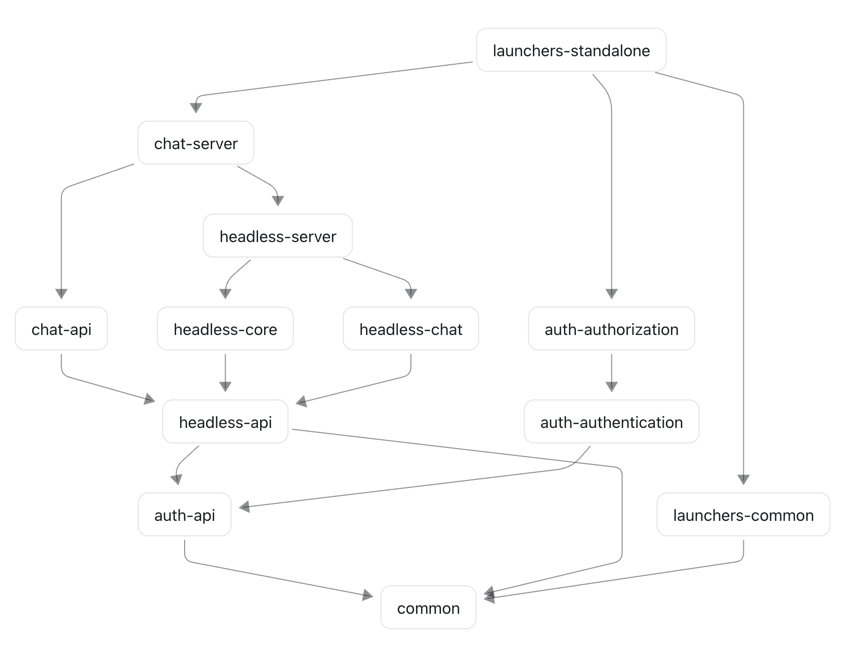
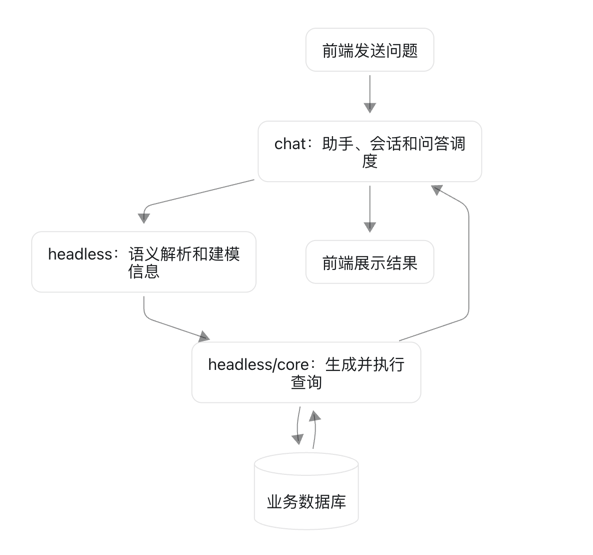

# SuperSonic 模块地图与设计分析

本文基于当前仓库的 Maven 依赖、启动入口和业务实现整理。模块关系描述代码现状；设计意义与改进方向属于结合实现作出的分析。

## 1. 总体定位

项目更接近**可组合的模块化单体**：代码拆分为多个 Maven 模块，通常通过 `StandaloneLauncher` 组合成一个后端 Java 进程运行。模块多不代表需要启动多个服务。

整体分层思路明确，但部分命名、依赖边界和启动初始化行为不够一致，增加了理解与维护成本。

## 2. 完整模块地图

当前共 19 个 Maven 模块：5 个 `packaging=pom` 的父模块，14 个 JAR 模块。

```text
supersonic                         根父模块：版本、依赖和构建配置
├── common                        公共能力
│
├── auth                          认证授权父模块
│   ├── api                       用户、权限相关对象与接口
│   ├── authentication            登录、Token、身份识别
│   └── authorization             资源权限判断
│
├── headless                      语义引擎父模块
│   ├── api                       语义查询与建模的数据结构
│   ├── core                      SQL 转换与查询执行
│   ├── chat                      自然语言到语义查询的解析
│   └── server                    建模管理、服务实现和 HTTP 接口
│
├── chat                          对话应用父模块
│   ├── api                       对话请求、响应等公共对象
│   └── server                    助手、会话、问答流程和结果处理
│
└── launchers                     启动组装父模块
    ├── common                    共用的 Web 和启动配套配置
    ├── headless                  语义服务启动入口
    ├── chat                      聊天服务启动入口
    └── standalone                完整后端启动入口
```

`supersonic`、`auth`、`headless`、`chat`、`launchers` 是父模块，主要组织构建、继承配置，自身不是运行中的服务。`<modules>` 表示构建组织关系；`<dependencies>` 才表示模块之间的代码依赖。

其他重要目录：

| 目录 | 定位 |
|---|---|
| `webapp` | 前端页面及聊天 SDK |
| `evaluation` | Python/Shell 评测工具，验证问数效果和查询执行准确率 |
| `assembly` | 打包、启动和部署脚本 |
| `docker` | 容器部署配置 |

## 3. 各模块职责

| 模块 | 主要职责 |
|---|---|
| `common` | 公共对象、工具、配置、大模型接入、Embedding、系统配置与模型配置管理等 |
| `auth/api` | 用户、组织、Token、权限相关对象及服务接口 |
| `auth/authentication` | 用户登录、Token、请求身份识别，回答“用户是谁” |
| `auth/authorization` | 资源访问与操作权限判断，回答“用户能做什么” |
| `headless/api` | 语义查询、建模相关请求、响应和共享数据结构 |
| `headless/core` | SQL 转换、数据库连接及查询执行等核心能力 |
| `headless/chat` | 规则解析、大模型解析、查询匹配及纠错，将自然语言转换为语义查询 |
| `headless/server` | 数据源、主题域、模型、指标、维度、数据集管理，以及语义查询服务与 HTTP 接口 |
| `chat/api` | 助手问答流程使用的请求、响应等公共对象 |
| `chat/server` | 助手、会话、历史记录、问答调度、记忆和结果处理 |
| `launchers/common` | 统一响应、异常处理、Web 配置等启动配套能力，无独立启动入口 |
| `launchers/headless` | `HeadlessLauncher`、语义服务运行配置和打包配置 |
| `launchers/chat` | `ChatLauncher`、聊天服务运行配置和打包配置；当前依赖完整性需要单独验证 |
| `launchers/standalone` | `StandaloneLauncher`，组合聊天、语义查询、认证授权等后端能力 |

### 容易混淆的名称

| 名称 | 区别 |
|---|---|
| `chat` 与 `headless/chat` | 前者关注“一次对话怎么处理”，后者关注“这句话对应怎样的数据查询” |
| `common` 与 `launchers/common` | 前者包含全项目公共能力；后者集中在 Web 和启动配套配置 |
| `headless/server` 与 `launchers/headless` | 前者提供业务实现和接口；后者负责将它们组装并启动 |

`api` 并不等于 HTTP Controller 所在模块。这里的 `api` 更多表示供其他模块引用的对象与约定，Controller 大多在 `server` 中。

## 4. 实际 Maven 依赖

以下表格仅列当前各 JAR 模块对项目内部模块的直接依赖，不包含第三方依赖和传递依赖。

| 模块 | 直接依赖的内部模块 |
|---|---|
| `common` | 无 |
| `auth-api` | `common` |
| `auth-authentication` | `auth-api`、`common` |
| `auth-authorization` | `auth-api`、`auth-authentication` |
| `headless-api` | `common`、`auth-api` |
| `headless-core` | `headless-api` |
| `headless-chat` | `headless-api` |
| `headless-server` | `headless-core`、`headless-chat` |
| `chat-api` | `auth-api`、`headless-api` |
| `chat-server` | `auth-api`、`chat-api`、`headless-server` |
| `launchers-common` | `common` |
| `launchers-chat` | `launchers-common`、`auth-authorization`、`auth-authentication` |
| `launchers-headless` | `headless-core`、`headless-server`、`launchers-common`、`auth-authentication`、`auth-authorization`、`auth-api` |
| `launchers-standalone` | `launchers-common`、`chat-server`、`chat-api`、`auth-authorization`、`headless-core`、`headless-server`、`auth-api` |

下面是简化依赖图，箭头表示“依赖”，不是启动顺序；部分重复依赖已省略。



## 5. Standalone 如何组合这些模块

1. `launchers/standalone/pom.xml` 引入业务模块，使其代码进入运行时 classpath。
2. `StandaloneLauncher` 通过 `@SpringBootApplication` 扫描 `com.tencent.supersonic` 和 `dev.langchain4j`。
3. Spring 加载依赖模块中的 Controller、Service、Component 和 Configuration，创建 Bean 并注入依赖。
4. 启动同一个 Web 服务，对外提供接口；模块之间通过同一进程内的方法调用协作。
5. 启动阶段执行 `CommandLineRunner`，并通过 `@EnableScheduling`、`@EnableAsync` 支持定时和异步任务。

它不会依次调用 `ChatLauncher.main()` 和 `HeadlessLauncher.main()`。本地使用 standalone 时，后端只需运行 `StandaloneLauncher`，默认端口为 9080。

一次问数的简化流程：





“完整应用”指组合后的后端业务能力。前端开发服务、MySQL 和 Dify 等外部服务仍需独立提供。

## 6. 这种拆分可能带来的价值

以下属于根据实现推断的设计意图。

| 拆分方式 | 可能的价值 | 适用场景 |
|---|---|---|
| 对话应用与语义引擎分开 | 数据查询能力独立于聊天界面复用 | 其他系统直接查询指标、数据集 |
| `api` 与实现分开 | 共享约定，减少调用方对实现细节的依赖 | 多模块使用同一套请求、响应和接口 |
| `headless/core` 与 `headless/chat` 分开 | 区分查询执行与自然语言理解 | 替换解析策略，保留底层查询能力 |
| 认证与授权分开 | 区分身份识别与资源权限 | 接入企业登录，保留平台资源权限 |
| 功能模块与启动模块分开 | 同一套代码支持不同组合 | 完整部署或仅语义服务部署 |
| 独立评测工具 | 量化模型、提示词及代码修改的影响 | 调整 Text-to-SQL 后检查准确率变化 |

最有价值的边界是对话应用与语义引擎之间的分离：语义模型、指标、SQL 转换和查询执行本身具有独立使用价值。

## 7. 当前结构中的具体问题

### 7.1 common 职责和依赖过重

`common` 除工具与公共对象外，还包含模型配置持久化、Embedding、样例管理、系统配置 Controller，以及多种模型和向量库适配。

其依赖包括 Calcite、MyBatis、Web、多种 LangChain4j 集成和整个 `aws-java-sdk`。其他模块即使只需公共对象，也可能间接引入大量无关依赖。

这增加下载体积、版本冲突和理解成本。此前出现的大量 AWS SDK 下载需求，与这里的聚合依赖直接相关。

### 7.2 对话层直接依赖语义服务实现模块

`chat-server` 直接依赖 `headless-server`；调用的 `ChatLayerService`、`SemanticLayerService` 接口也位于 `headless/server`。

调用方为了获得接口，必须依赖服务实现模块，因此 `api` 拆分没有完全形成独立的调用边界。standalone 下使用方便，但替换实现或拆分成独立进程时仍需改造。

### 7.3 启动目录与实际依赖不完全一致

`launchers/chat/pom.xml` 当前没有声明 `chat-server` 依赖，现有内部依赖也没有通过它们引入聊天业务模块。

不能仅依据目录名认为单独启动 `ChatLauncher` 就能加载完整聊天功能。当前已明确组装完整后端能力的是 `launchers/standalone`。

### 7.4 演示初始化与正常启动耦合

Demo 作为 Spring 组件参与启动，通过 `S2BaseDemo.run()` 初始化数据。各 Demo 的判断条件不同：

| Demo | 判断是否已初始化的依据 |
|---|---|
| `S2SmallTalkDemo` | 是否存在名称为“闲聊助手”的助手 |
| `S2VisitsDemo` | 是否存在 `supersonic` 主题域 |
| `S2CompanyDemo` | 是否存在 `corporate` 主题域 |
| `S2SingerDemo` | 是否存在 `singer` 主题域 |

所以删除闲聊助手后重启会恢复，而只删除其他助手、保留主题域时不会恢复。

父类创建或复用演示数据源、大模型的步骤位于 `s2.demo.names` 判断之前。因此仅清空 Demo 名称配置，不能完全关闭所有演示初始化。SQL 演示脚本的执行也由另一套配置控制。

### 7.5 命名和重复配置增加维护成本

`chat`、`headless/chat`、`launchers/chat` 分处应用、引擎和启动三个层次，但名称相近。多个 POM 重复声明编译版本，也增加了调整版本时产生不一致的风险。

当前为兼容本地 Java 17 和 IDEA 导入问题补充的显式模块配置属于现状；后续可在验证构建与 IDE 导入一致后，重新集中管理。

## 8. 针对当前使用方式的建议

当前使用方式为本地部署、自己的 MySQL、Dify 和自定义助手。

| 部分 | 建议 |
|---|---|
| 对话层与语义引擎分离 | 保留，是核心业务边界 |
| 查询执行与自然语言解析分离 | 保留，便于调试和替换 |
| 认证与授权区分 | 保留职责区分，无需进一步拆细 |
| standalone 统一启动 | 继续作为主要启动方式 |
| common | 逐步收紧职责，避免继续堆积业务和无关依赖 |
| 多套启动入口 | 暂时聚焦 standalone，其他入口单独验证 |
| Demo 初始化 | 优先增加明确开关，统一 Java 与 SQL 演示初始化行为 |
| 编译版本与构建配置 | 验证兼容性后统一由父 POM 管理 |

不建议仅为减少目录数量就合并所有模块。更有收益的顺序是：先统一配置和初始化行为，再收紧 common 的职责，最后理顺对话层调用语义引擎的接口。

## 9. 主要代码入口

- 根构建配置：`pom.xml`
- 完整后端组装：`launchers/standalone/pom.xml`
- 启动类：`launchers/standalone/src/main/java/com/tencent/supersonic/StandaloneLauncher.java`
- 聊天模块依赖：`chat/server/pom.xml`
- 问答调度：`chat/server/src/main/java/com/tencent/supersonic/chat/server/service/impl/ChatQueryServiceImpl.java`
- 语义服务接口与实现：`headless/server/src/main/java/com/tencent/supersonic/headless/server/facade/`
- 公共依赖：`common/pom.xml`
- Demo 初始化入口：`launchers/standalone/src/main/java/com/tencent/supersonic/demo/S2BaseDemo.java`
- Demo 配置：`launchers/standalone/src/main/resources/s2-config.yaml`
- 评测说明：`evaluation/README.md`
